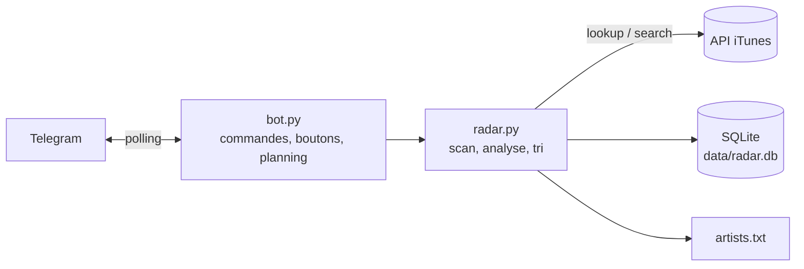

# Music Radar

Bot Telegram auto-hébergé qui surveille les nouvelles sorties d'une liste d'artistes
(~185) sur Apple Music et envoie un récap chaque matin, avec un tri en un appui.

## Pourquoi

Suivre beaucoup d'artistes, c'est rater des sorties ou les découvrir en retard.
L'API Spotify n'est plus utilisable avec un compte gratuit, et l'écoute se fait
sur Apple Music : le bot interroge donc l'API publique iTunes, sans clé, et
remplace la veille manuelle par un message quotidien trié.

## Fonctionnalités

- **Récap quotidien** (sauf vendredi) avec les sorties des 14 derniers jours
  pas encore notifiées : une sortie qu'Apple affiche en retard arrive quand même, et **récap hebdo le vendredi** avec les sorties de la semaine et
  celles annoncées pour les 7 jours suivants.
- **Tri en un appui** : chaque sortie arrive avec les boutons « ➕ Ajoutée »
  (rangée dans ma playlist) et « 🙈 Ignorer ». Au-delà de 12 sorties d'un coup,
  le récap passe en liste compacte et `/trier` les présente une par une.
- **Analyse de nouveauté** : pour chaque album ou EP, la liste des titres est
  comparée aux singles déjà sortis et, pour une réédition, à l'album d'origine
  (« 🆕 8 inédits sur 14 · 6 déjà sortis en single », « ♻️ réédition · aucun
  inédit »). Les rééditions sans aucun titre nouveau sont mises de côté.
- **Versions alternatives** (slowed, sped up, instru, remix…) repérées et
  rattachées à leur original : « 🔁 version slowed de « Album » ».
- **Dédoublonnage** : Apple publie souvent plusieurs fiches pour une même sortie
  (explicite / clean). Une seule est gardée, de préférence l'explicite, et le
  tri déjà fait est conservé.
- **Gestion des artistes depuis Telegram** : `/ajouter` accepte un nom ou le
  lien de la page Apple Music, et propose des boutons en cas d'homonymes.
- **Erreurs signalées sur Telegram**, token masqué, et logs persistants.

## Commandes

| Commande | Effet |
|---|---|
| `/trier` | Passer en revue les sorties pas encore triées |
| `/ajouter <nom ou lien>` | Suivre un artiste (`Nom`, `Nom \| id` ou URL Apple Music) |
| `/retirer <nom>` | Ne plus suivre un artiste |
| `/artistes [filtre]` | Artistes suivis |
| `/jour`, `/semaine` | Récaps à la demande |
| `/rattrapage <n>` | Sorties des n derniers jours |
| `/actualiser` | Relire `artists.txt` |

## Architecture



- `radar.py` : toute la logique, sans dépendance Telegram, donc testable seule.
  Scan des artistes, analyse de nouveauté, dédoublonnage, états de tri, mise en
  forme HTML des messages.
- `bot.py` : interface Telegram ([python-telegram-bot](https://python-telegram-bot.org/)),
  planification (JobQueue), boutons inline, gestion des erreurs.
- **SQLite** : ID des artistes, sorties notifiées, état de tri, titres des
  albums analysés (servent de cache et de base de comparaison).

### Choix techniques

- **Respect du débit iTunes** (~20 requêtes/min, limite non officielle) :
  3,2 s entre deux appels, un seul scan à la fois (`asyncio.Lock`), appels
  bloquants dans `asyncio.to_thread` pour ne jamais figer le bot.
- **Pas de doublon de notification** : une sortie n'est marquée « notifiée »
  qu'après l'envoi réussi sur Telegram ; en cas d'échec, elle repart le lendemain.
- **`artists.txt` monté en fichier unique** dans le conteneur : il est réécrit
  sur place (jamais remplacé), sinon le montage Docker casserait.
- **Migrations de base** au démarrage, sans appel réseau, pour faire évoluer
  les données existantes avec le code.

## Installation

Prérequis : Docker et Docker Compose, un bot Telegram créé avec @BotFather.

```bash
git clone https://github.com/<toi>/music-radar.git
cd music-radar
cp .env.example .env                  # puis renseigner le token et le chat ID
cp artists.example.txt artists.txt    # à créer AVANT le premier lancement
docker compose up -d --build
```

> Si `artists.txt` n'existe pas au premier lancement, Docker crée un
> **dossier** à sa place et le bot ne démarre pas.

### Mettre à jour

Sur le PC, `publier.cmd` (double-clic) envoie les modifications sur GitHub,
avec un garde-fou qui refuse de publier `.env` ou `artists.txt`.
Sur le serveur :

```bash
bash deploy.sh    # git pull + reconstruction du conteneur
```

`.env`, `artists.txt` et `data/` ne sont pas suivis par Git : une mise à jour
ne touche jamais au token, à la liste d'artistes ni à la base.

## Configuration (`.env`)

| Variable | Défaut | Rôle |
|---|---|---|
| `TELEGRAM_BOT_TOKEN`, `TELEGRAM_CHAT_ID` | — | Bot et seul chat autorisé |
| `DAILY_TIME`, `WEEKLY_TIME` | `09:00` | Heures d'envoi (Europe/Paris) |
| `SEND_EMPTY_DAILY` | `0` | `1` = message « Rien de nouveau » les jours vides |
| `DAILY_LOOKBACK_DAYS` | `14` | Jours couverts par le récap quotidien |
| `CARDS_MAX` | `12` | Au-delà : liste compacte + `/trier` |
| `COVERS` | `small` | Pochette en miniature (`off` pour désactiver) |
| `NOVELTY` | `1` | Analyse de nouveauté (1 appel iTunes par album) |
| `UPCOMING_DAYS`, `UPCOMING_MAX` | `7`, `8` | Sorties à venir du vendredi |
| `ITUNES_COUNTRY` | `fr` | Catalogue Apple Music |

## Tests

```bash
pip install -r requirements-dev.txt
pytest
ruff check .
```

94 tests, sans aucun accès réseau : l'API iTunes et Telegram sont simulés.
Ils sont lancés par GitHub Actions à chaque push.

## Limites connues

- L'API iTunes peut afficher une sortie avec plusieurs jours de retard sur
  l'appli Music : elle arrive alors dans le récap qui suit son apparition.
- Un featuring sur l'album d'un autre artiste n'est pas listé par Apple dans
  les sorties de l'artiste invité : seuls les singles en featuring le sont.
- Le bot ne connaît pas l'historique d'écoute : « déjà sorti » veut dire « déjà
  publié par l'artiste », pas « déjà écouté ».
- Ajouter automatiquement à une playlist Apple Music demanderait l'API Apple
  Music et un compte Apple Developer payant.
