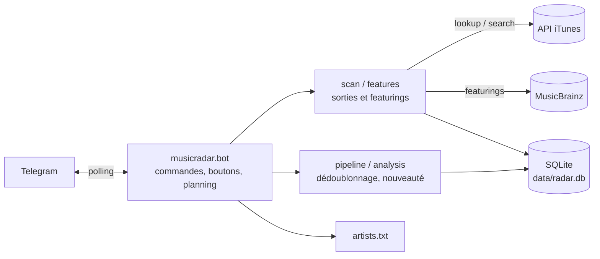

# Music Radar

Bot Telegram auto-hébergé qui surveille les nouvelles sorties d'une liste d'artistes
(~185) sur Apple Music et envoie un récap chaque matin, avec un tri en un appui.

## Pourquoi

Suivre beaucoup d'artistes, c'est rater des sorties ou les découvrir en retard.
L'API Spotify n'est plus utilisable avec un compte gratuit, et l'écoute se fait
sur Apple Music : le bot interroge donc l'API publique iTunes, sans clé, et
remplace la veille manuelle par un message quotidien trié.

## Fonctionnalités

- **Récap quotidien** (sauf vendredi) avec les sorties des 14 derniers jours
  pas encore notifiées : une sortie qu'Apple affiche en retard arrive quand même.
- **Récap du vendredi** : les sorties pas encore notifiées (le gros des sorties
  tombe le vendredi), un rappel du nombre de sorties qui attendent encore dans
  `/trier`, et celles annoncées pour les 7 jours suivants.
- **Tri en un appui** : chaque sortie arrive avec les boutons « ➕ Ajoutée »
  (rangée dans ma playlist) et « 🙈 Ignorer ». Au-delà de 12 sorties d'un coup,
  le récap passe en liste compacte et `/trier` les présente une par une.
- **Analyse de nouveauté** : pour chaque album ou EP, la liste des titres est
  comparée aux singles déjà sortis et, pour une réédition, à l'album d'origine
  (« 🆕 8 inédits sur 14 · 6 déjà sortis en single », « ♻️ réédition · aucun
  inédit »), avec la liste des titres concernés (« ↳ Déjà sortis : A · B »)
  pour ne pas ajouter deux fois le même son à la playlist. Les rééditions sans
  aucun titre nouveau sont mises de côté.
- **Featurings sur le projet d'un autre artiste** : Apple ne les range pas dans
  les sorties de l'artiste invité. Le bot les trouve via
  [MusicBrainz](https://musicbrainz.org), qui relie les invités par identifiant
  (chaque artiste est associé à sa fiche MusicBrainz par son lien Apple Music,
  donc sans confusion entre homonymes), puis retrouve le titre chez Apple :
  « 🎤 Quavo en featuring · album « … » ». Pour un artiste absent de
  MusicBrainz, une recherche par nom chez Apple prend le relais.
- **Versions alternatives** (slowed, sped up, instru, remix…) repérées et
  rattachées à leur original : « 🔁 version slowed de « Album » ».
- **Dédoublonnage** : Apple publie souvent plusieurs fiches pour une même sortie
  (explicite / clean). Une seule est gardée, de préférence l'explicite, et le
  tri déjà fait est conservé.
- **Gestion des artistes depuis Telegram** : `/ajouter` accepte un nom ou le
  lien de la page Apple Music, et propose des boutons en cas d'homonymes.
  `/verifier` liste les artistes au nom ambigu pour confirmer ou changer d'homonyme.
- **Erreurs signalées sur Telegram**, token masqué, et logs persistants.

## Commandes

| Commande | Effet |
|---|---|
| `/trier` | Passer en revue les sorties pas encore triées |
| `/ajouter <nom ou lien>` | Suivre un artiste (`Nom`, `Nom \| id` ou URL Apple Music) |
| `/retirer <nom>` | Ne plus suivre un artiste |
| `/artistes [filtre]` | Artistes suivis |
| `/verifier` | Vérifier les artistes dont le nom est porté par plusieurs artistes chez Apple |
| `/jour`, `/semaine` | Récaps à la demande |
| `/rattrapage <n>` | Sorties des n derniers jours |
| `/actualiser` | Relire `artists.txt` |

## Architecture



Le cœur (`musicradar/`) ne dépend pas de Telegram : il se teste et se lance
seul. L'interface Telegram (`musicradar/bot/`) ne fait qu'appeler ce cœur.

| Module | Rôle |
|---|---|
| `config.py`, `clock.py` | Réglages (`.env`) et date du jour |
| `ratelimit.py` | Délai minimal entre deux appels à un même service |
| `models.py` | `Release`, `Batch`, `Prepared` et états de tri |
| `text.py` | Normalisation des noms et titres, éditions, versions alternatives |
| `storage.py` | Base SQLite : schéma, migrations, file de tri, sauvegardes |
| `sources/itunes.py` | API iTunes : débit limité, catalogue, recherche, titres |
| `sources/musicbrainz.py` | API MusicBrainz : fiche de l'artiste, enregistrements crédités |
| `artists.py` | `artists.txt`, résolution des ID, `/ajouter`, homonymes |
| `scan.py` | Scan des artistes suivis, coupe-circuit en cas de panne d'Apple |
| `features.py` | Featurings sur les projets d'autres artistes |
| `analysis.py` | Nouveauté : inédits, singles déjà sortis, rééditions |
| `pipeline.py` | Préparation d'un récap, puis marquage « notifié » après l'envoi |
| `formatting.py` | Mise en forme HTML des messages Telegram |
| `bot/recaps.py` | Récaps planifiés et à la demande, nouvel essai en cas d'échec |
| `bot/sorting.py` | Boutons des cartes et file `/trier` |
| `bot/artists.py` | `/ajouter`, `/retirer`, `/artistes`, `/verifier` |
| `bot/ui.py`, `bot/app.py` | Envoi des messages, claviers, erreurs, démarrage |

Pour diagnostiquer sans rien envoyer sur Telegram :

```bash
docker compose exec music-radar python -m musicradar daily     # ou weekly, resolve, catchup 30
```

### Choix techniques

- **Respect du débit iTunes** (~20 requêtes/min, limite non officielle) :
  3,2 s entre deux appels, garantis par un limiteur commun à tous les threads
  (`ratelimit.py`), un seul scan à la fois (`asyncio.Lock`), appels bloquants
  dans `asyncio.to_thread` pour ne jamais figer le bot.
- **MusicBrainz en parallèle** : sa limite de débit (1 requête/s) est
  indépendante de celle d'Apple, il est donc interrogé dans un thread à part
  pendant que le scan lit les catalogues.
- **Pas de doublon de notification** : une sortie n'est marquée « notifiée »
  qu'après l'envoi réussi sur Telegram ; en cas d'échec, elle repart au récap
  suivant.
- **Résistance aux pannes** : si Apple échoue 5 fois d'affilée, le scan
  s'arrête au lieu de traîner des heures, et le récap est retenté une fois
  1 h plus tard (le récap sur 14 jours rattrape le reste). Si MusicBrainz
  tombe, la recherche Apple prend le relais pour la suite du scan.
- **Une seule notification par récap** : l'en-tête sonne, les cartes arrivent
  en silence.
- **Sauvegarde quotidienne** de la base dans `data/backups/` (7 jours gardés),
  via l'API de sauvegarde SQLite, cohérente même pendant une écriture.
- **`artists.txt` monté en fichier unique** dans le conteneur : il est réécrit
  sur place (jamais remplacé), sinon le montage Docker casserait.
- **Migrations de base** au démarrage, sans appel réseau, pour faire évoluer
  les données existantes avec le code.

## Installation

Prérequis : Docker et Docker Compose, un bot Telegram créé avec @BotFather.

```bash
git clone https://github.com/GalaanB/music-radar.git
cd music-radar
cp .env.example .env                  # puis renseigner le token et le chat ID
cp artists.example.txt artists.txt    # à créer AVANT le premier lancement
docker compose up -d --build
```

> Si `artists.txt` n'existe pas au premier lancement, Docker crée un
> **dossier** à sa place et le bot ne démarre pas.

### Mettre à jour

Pousser les modifications sur GitHub (VS Code ou `git push`), puis sur le serveur :

```bash
bash deploy.sh    # git pull + reconstruction du conteneur
```

`.env`, `artists.txt` et `data/` ne sont pas suivis par Git : une mise à jour
ne touche jamais au token, à la liste d'artistes ni à la base.

## Configuration (`.env`)

| Variable | Défaut | Rôle |
|---|---|---|
| `TELEGRAM_BOT_TOKEN`, `TELEGRAM_CHAT_ID` | — | Bot et seul chat autorisé |
| `DAILY_TIME`, `WEEKLY_TIME` | `09:00` | Heure de lancement du scan (Europe/Paris), ~20 min avant le message |
| `SEND_EMPTY_DAILY` | `0` | `1` = message « Rien de nouveau » les jours vides |
| `DAILY_LOOKBACK_DAYS` | `14` | Jours couverts par le récap quotidien |
| `FEATURES` | `1` | Recherche des featurings (scan ~15-20 min au lieu de ~10) |
| `MUSICBRAINZ` | `1` | Featurings via MusicBrainz (`0` : recherche par nom chez Apple seulement) |
| `CARDS_MAX` | `12` | Au-delà : liste compacte + `/trier` |
| `COVERS` | `small` | Pochette en miniature (`off` pour désactiver) |
| `NOVELTY` | `1` | Analyse de nouveauté (1 appel iTunes par album) |
| `UPCOMING_DAYS`, `UPCOMING_MAX` | `7`, `8` | Sorties à venir du vendredi |
| `ITUNES_COUNTRY` | `fr` | Catalogue Apple Music |

## Tests

```bash
pip install -r requirements-dev.txt
pytest
ruff check .
```

152 tests, sans aucun accès réseau : l'API iTunes, MusicBrainz et Telegram sont simulés.
Ils sont lancés par GitHub Actions à chaque push.

## Limites connues

- L'API iTunes peut afficher une sortie avec plusieurs jours de retard sur
  l'appli Music : elle arrive alors dans le récap qui suit son apparition.
- Les featurings dépendent de MusicBrainz, une base communautaire : un titre
  très récent peut y apparaître avec quelques jours de retard (le récap sur
  14 jours le rattrape). Pour les artistes absents de MusicBrainz, la recherche
  par nom chez Apple manque des featurings d'artistes très prolifiques, et
  n'est pas faite pour les noms portés par plusieurs artistes (SAM, Luv…).
- Le bot ne connaît pas l'historique d'écoute : « déjà sorti » veut dire « déjà
  publié par l'artiste », pas « déjà écouté ».
- Ajouter automatiquement à une playlist Apple Music demanderait l'API Apple
  Music et un compte Apple Developer payant.
